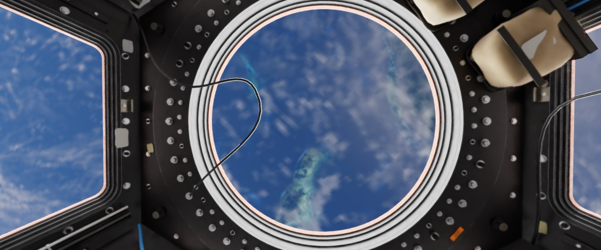
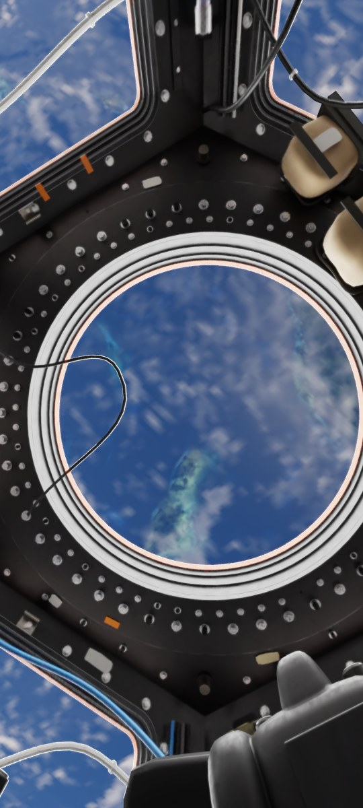
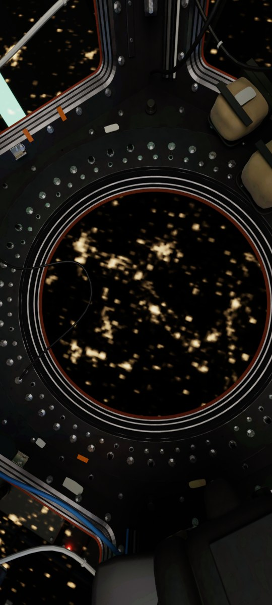
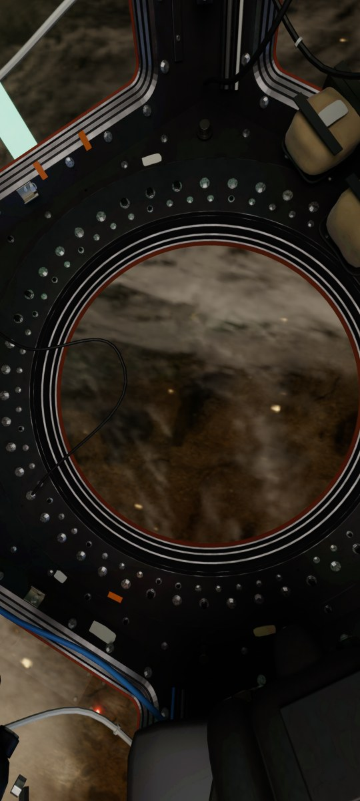
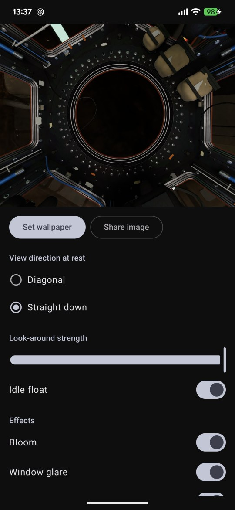

# Cupola: ISS Live Wallpaper



An Android live wallpaper that shows the Earth from inside the Cupola, the seven-window observation module of the
International Space Station, on a realistic orbit computed on the phone. Everything runs on the device; the only
network use is a daily download of public ISS orbit data, which can be turned off.

<p align="center">
  <a href="https://play.google.com/store/apps/details?id=com.baer.cupola">
    
  </a>
</p>

<p align="center">
  
  
  
  
</p>

## Features

- Orbit: SGP4 on bundled orbit data (refreshed per release), with day and night, sunrise and sunset
- Earth: NASA Blue Marble colours by month, relief, ocean glint, an atmosphere computed from lookup tables, clouds
  that drift and change over days, city lights, moonlight, aurora, lightning, airglow, the Moon and the stars
- Cabin: a baked panorama of the Cupola interior; look around by tilting the phone or swiping home screen pages
  (launchers that send wallpaper offsets); two rest views (diagonal, straight down)
- Effects: bloom, window glare, glass reflections, dust, each with its own switch
- Info screen: the place below the station, its local time and daylight, the next pass over a home city, which is
  also marked on the wallpaper when it is in view
- Share the current view as an image
- Material You: the system colours follow the current frame

Requires Android 13 (API 33) or newer and Vulkan 1.1.

## One-time purchase

Cupola is a paid app with a single one-time purchase on Google Play: no subscription, no ads, no in-app purchases.

## Privacy

Cupola is tracker-free.

- No account, no analytics, no crash reporters, no advertising
- At most once a day, while the wallpaper is visible, it downloads the public ISS orbit data (`iss.tle`, `iss.json`)
  from this project's GitHub Pages site; "Update orbit data online" in the settings turns this off
- No runtime permissions; the motion sensor is read only while the wallpaper is visible
- Settings and the home city stay in the app's private storage; cloud backup and device transfer are off

Full policy: [PRIVACY.md](PRIVACY.md). Support and feedback: [GitHub issues](https://github.com/IT-BAER/cupola-android/issues).

## Stack

- Kotlin 2.4.21, Jetpack Compose (BOM 2026.09.00), Material 3, Hilt 2.60.1
- Vulkan renderer in C++ (NDK 30.0.16248370), KTX2 textures in an install-time asset pack
- AGP 9.4.1, Gradle 9.8.1, JDK 17
- minSdk 33 (Android 13), target and compile SDK 37

## Modules

| Module | Content |
|---|---|
| `:app` | Wallpaper service, settings Activity, render host and sessions |
| `:core:render` | Vulkan renderer (C++, `src/main/cpp`, shader `shaders/earth.frag`) and the scene inputs |
| `:core:orbit` | SGP4, frames, Sun and Moon, pass prediction |
| `:feature:settings` | Settings, Info, home city search, credits (Compose) |
| `:earthpack` | Install-time asset pack with the Earth and cabin textures |
| `:tools:tle`, `:tools:geoindex` | Build-time orbit data and city index tools |

Texture and panorama contracts: `tools/textures/README.md`, `tools/blender/README.md`. Plan: `docs/plan.md`.

## Build and test

```bash
./gradlew build
```

```bash
./gradlew testDebugUnitTest
```

Native host tests (KTX2 reader, atmosphere lookup tables, sky lookup-table reuse):

```bash
cmake -S core/render/src/test/cpp -B build/host-tests -G Ninja && cmake --build build/host-tests && ctest --test-dir build/host-tests
```

The instrumented tests (`EarthRenderTest`, goldens and seam sweep included) need the app installed from the bundle
(`bundletool install-apks`), because plain APKs carry no asset pack. Goldens are device renders in
`app/src/androidTest/assets/goldens`.

The screenshots in `docs/images/` are device captures of the debug build (Gate `capture` command) at real ISS passes
from the bundled orbit data.

## Credits

NASA Earth Observatory (Blue Marble, Black Marble), NOAA ETOPO 2022, ESO (Milky Way panorama), GeoNames, Natural
Earth, CelesTrak / US Space Force orbit data; the full list ships in the app (Credits screen,
`app/src/main/assets/credits.tsv`).

## License

Source-available, all rights reserved; see [LICENSE](LICENSE). Third-party components keep their own licences.
